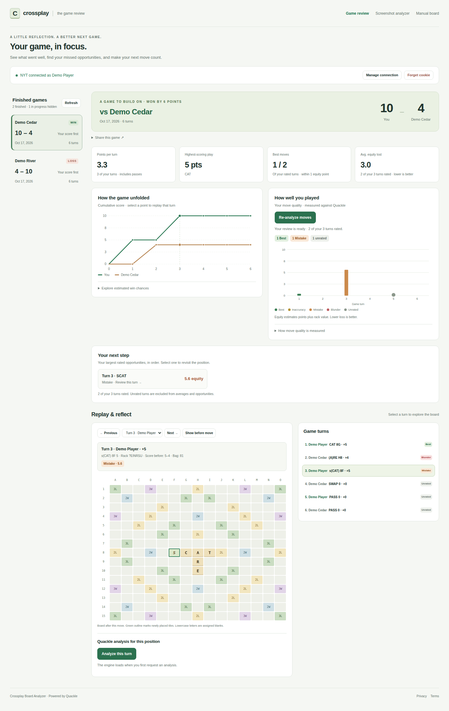
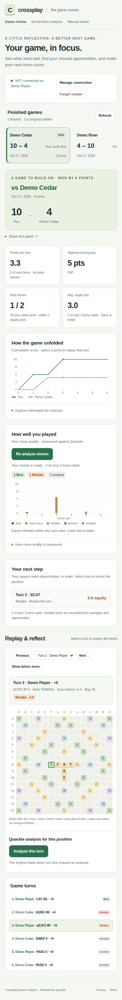
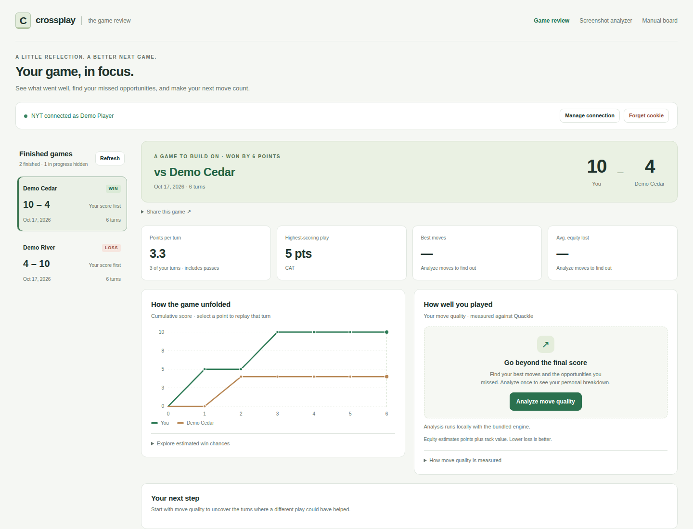

# Game review UI validation

The review now starts with the result, labeled player scores, personal scoring
stats, and a score timeline. Move-quality summaries and suggested turns to
revisit use only the game owner's rated moves. Unrated moves are excluded from
averages, and incomplete analysis is labeled.

These screenshots were captured with `playwright-cli` against `npm run frontend`.
All games and players are synthetic. The analyzed views use the explicit
saved-analysis display fixture in `tools/fixtures/review-analysis.json`; those
illustrative equity values are not measured Quackle results. The browser suite
separately exercises both whole-game move quality and 277-sample turn analysis
with the bundled real engine.

Validation: `npm test` and `CROSSPLAY_TEST_BASE_URL=http://127.0.0.1:8000 npm run test:review`.
The review tests cover wins, losses, draws, missing scores, final score adjustments,
owner-only averages, unrated and incomplete analysis, keyboard chart navigation,
opportunity-to-replay links, sharing, and layouts at 320, 390, 768, 1024, and 1440px.

## Desktop review (1440px)

The game owner's two rated moves average 3.0 equity lost. The opponent's 12.4-point
loss is deliberately absent from the personal summary and suggested opportunities.
Selecting the opportunity opens turn 3, including its assigned blank tile.

## Mobile review (390px)

Cards stack, games scroll within their own list, and the entire 15×15 board fits
without horizontal page scrolling.

## Before analysis (1440px)

Scoring stats and the score timeline are available immediately. Engine-dependent
stats remain unfilled until analysis, with a clear action to generate the review.

